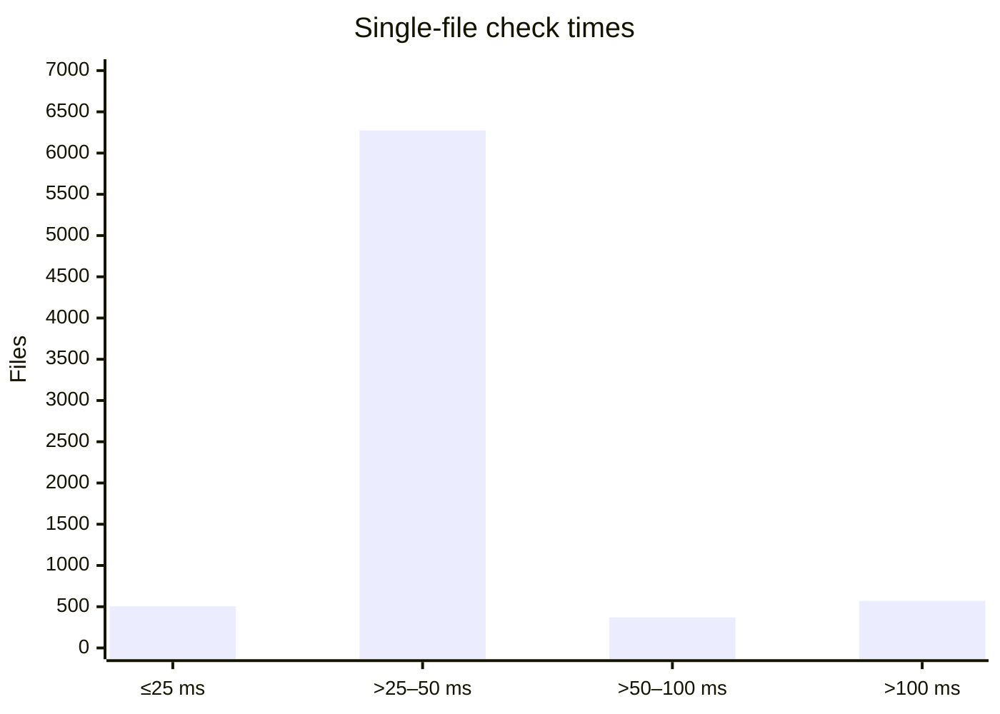

# tift — A fast LaTeX and BibTeX formatter


[](https://www.rust-lang.org/)
[](LICENSE)

tift is a fast, configurable formatter for LaTeX and BibTeX. Keep documents consistently indented, align tables and equations, and format bibliographies from the command line or your editor. Available on Windows, Linux, and macOS.

**[Homepage](https://primex-06.github.io/tift/)** · **[User guide](https://github.com/PrimeX-06/tift/wiki)** · **[Formatting examples](https://github.com/PrimeX-06/tift/wiki/Formatting-Examples)** · **[Discussions](https://github.com/PrimeX-06/tift/discussions)** · **[Report an issue](https://github.com/PrimeX-06/tift/issues)**


## Features

- Indent nested LaTeX environments and lists, and align equations and table columns.
- Tidy entries in `.bib` bibliographies and format the `.bst` files that tell BibTeX how to display them.
- Keep existing prose line breaks or wrap paragraphs to a chosen width. Chinese, Japanese, and Korean text is supported.
- Format a whole project, limit edits to lines changed in Git, or check formatting in CI.

## Install

### Download a prebuilt binary (recommended)

Download a Windows, Linux, or macOS archive from the [tift 0.2.0 release](https://github.com/PrimeX-06/tift/releases/tag/v0.2.0), extract the executable, and add its directory to `PATH`.

### Install with Cargo

Install with Cargo using **Rust 1.99.1 or later**:

```sh
cargo install tift --locked --registry crates-io
tift --version
```

See the [installation guide](https://github.com/PrimeX-06/tift/wiki/Getting-Started) for platform setup, updates, and troubleshooting.

## Quick start

```sh
tift --diff main.tex              # preview formatting
tift main.tex                     # apply it to this file
tift .                            # format the whole project
tift --check .                    # check formatting in CI
```

In a Git project, run `tift --diff --changed-since HEAD` to preview formatting on lines edited since your last commit. To preview a bibliography or its style file, use `tift --diff references.bib` or `tift --diff journal.bst`. [Command-line guide](https://github.com/PrimeX-06/tift/wiki/CLI)

## Performance

**33.4 ms to check a single TeX file** with tift 0.1.9 on Windows 11 (median, including CLI startup). Across all 7,720 files, 87.8% finished within 50 ms.



<details>
<summary>Benchmark setup and reproduction</summary>

tift 0.1.9 checked the TeX sources of 721 papers. Nine files from a paper missing `astra-plain.bst` were excluded. [Benchmark corpus](https://github.com/openai/math/tree/adc7f1241b42e322a6451854ab7e4b4c146bf78a)

Each file’s time is the median of three separate CLI runs with one worker, default settings, and the tift cache disabled on Windows 11 (Core i9-14900HX). The chart includes all 429 files that reported errors.

```sh
python performance/openai_math.py --tift path/to/tift --all-files --runs 3
```

</details>

## Configuration

To indent by four spaces and wrap prose at 88 columns, save this as `tift.toml` beside your project's `main.tex`.

```toml
[indent]
width = 4

[wrap]
mode = "wrap"
columns = 88
```

tift loads the file automatically when you format the project. [Annotated configuration for 0.2.0](https://github.com/PrimeX-06/tift/blob/v0.2.0/examples/tift.toml)

## Editor

To format on save in VS Code, install [LaTeX Workshop](https://marketplace.visualstudio.com/items?itemName=James-Yu.latex-workshop) and add this to `.vscode/settings.json`:

```json
{
    "latex-workshop.formatting.latex": "latexindent",
    "latex-workshop.formatting.latexindent.path": "tift",
    "latex-workshop.formatting.latexindent.args": ["--print", "%TMPFILE%"],
    "[latex]": {
        "editor.defaultFormatter": "James-Yu.latex-workshop",
        "editor.formatOnSave": true
    }
}
```

See the [editor guide](https://github.com/PrimeX-06/tift/wiki/VS-Code) for setup details and troubleshooting.

## Documentation

| Guide | Contents |
|---|---|
| [Formatting examples](https://github.com/PrimeX-06/tift/wiki/Formatting-Examples) | See how documents, tables, equations, and bibliographies are formatted |
| [Math](https://github.com/PrimeX-06/tift/wiki/Math-Formatting), [tables](https://github.com/PrimeX-06/tift/wiki/Table-Alignment), [bibliographies](https://github.com/PrimeX-06/tift/wiki/BibTeX), and [code](https://github.com/PrimeX-06/tift/wiki/Code-Formatting) | Feature behavior and settings |
| [Configuration](https://github.com/PrimeX-06/tift/wiki/Configuration) | Customize formatting rules |
| [Editor integration](https://github.com/PrimeX-06/tift/wiki/Editor-Integration) | VS Code, Neovim, pre-commit, and CI |
| [Supported syntax](https://github.com/PrimeX-06/tift/wiki/Supported-Syntax) | File types, packages, and formatting controls |

## License

[MIT](LICENSE).
