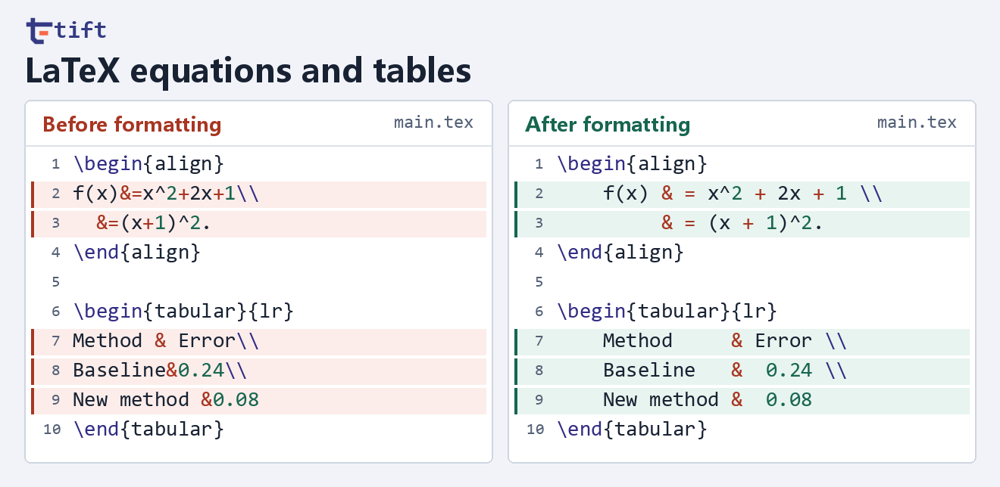
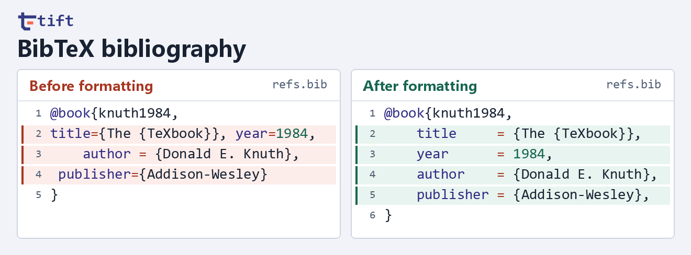
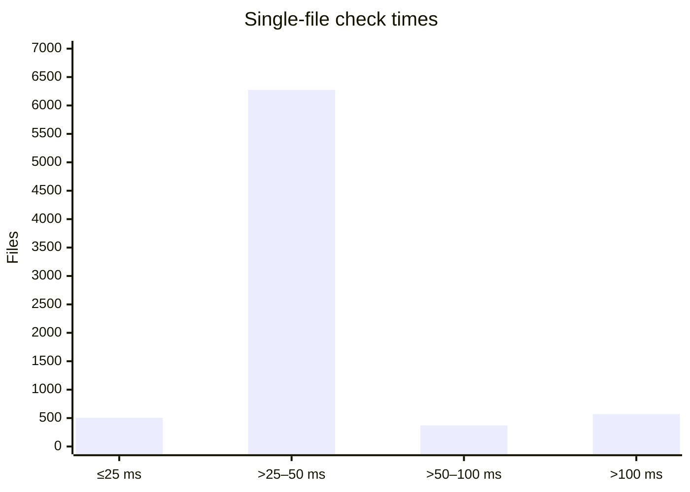

# tift — A fast LaTeX and BibTeX formatter


[](https://www.rust-lang.org/)
[](LICENSE)

tift is a fast, configurable formatter for LaTeX and BibTeX. Keep documents consistently indented, align tables and equations, and format bibliographies from the command line or your editor. Available on Windows, Linux, and macOS.

**[Homepage](https://primex-06.github.io/tift/)** · **[User guide](https://github.com/PrimeX-06/tift/wiki)** · **[Formatting examples](https://github.com/PrimeX-06/tift/wiki/Formatting-Examples)** · **[Discussions](https://github.com/PrimeX-06/tift/discussions)** · **[Report an issue](https://github.com/PrimeX-06/tift/issues)**





## Features

- Indent LaTeX environments, lists, and nested structures.
- Align table columns, paired equations, matrices, and inline PGFPlots data tables, and format math spacing.
- Format standalone and embedded BibTeX and BibLaTeX bibliographies, with optional sorting and cleanup.
- Format classic BibTeX style programs (`.bst`), including field declarations, postfix expressions, and nested functions.
- Wrap prose at nearby sentence endings and keep references such as `Figure \ref{fig:setup}` and quantities such as `250 ms` together.
- Support common LaTeX packages and CJK documents.
- Preserve verbatim content and allow local formatting controls.
- Format whole projects, preview changes, and check formatting in CI.

## Install

### Download a prebuilt binary (recommended)

Download an archive for Windows, Linux, or macOS from the [latest GitHub Release](https://github.com/PrimeX-06/tift/releases/latest), extract the executable, and add its directory to `PATH`.

### Install with Cargo

Install with Cargo using **Rust 1.99.1 or later**:

```sh
cargo install tift --locked --registry crates-io
tift --version
```

See the [installation guide](https://github.com/PrimeX-06/tift/wiki/Getting-Started) for platform setup, updates, and troubleshooting.

## Quick start

```sh
tift --diff main.tex                # preview changes
tift --diff journal.bst             # preview a bibliography style
tift main.tex                       # format a file in place
tift .                              # format a project recursively
tift --check .                      # check formatting in CI
tift --wrap --wrap-width 88 main.tex # wrap long prose
tift --dump-config > tift.toml      # create a project configuration
```

Formatting preserves prose line breaks by default. Add `--backup` to keep a copy of each file before formatting.

Concurrent tift processes serialize writes to the same output path, including backup rotation. Hidden `.tift-lock-*` files next to outputs provide a stable lock across atomic replacements.

Files use UTF-8 by default. Declare another encoding in a header comment, such as `% !TeX encoding = windows-1252` or `% Encoding: latin1` in a bibliography. Formatting preserves the declared encoding.

Use `tift --help` or the [command-line guide](https://github.com/PrimeX-06/tift/wiki/CLI) for more options.

## Performance

**33.4 ms to check a single TeX file** (median, including CLI startup). Across all 7,720 files, 87.8% finished within 50 ms.



tift 0.1.9 checked every `.tex` file in 721 [OpenAI Math papers](https://github.com/openai/math/tree/adc7f1241b42e322a6451854ab7e4b4c146bf78a). The benchmark excludes nine files from the paper missing `astra-plain.bst`.

Each file’s time is the median of three separate CLI runs with one worker, default settings, and the tift cache disabled on Windows 11 (Core i9-14900HX). The chart includes all 429 files that reported errors.

```sh
python performance/openai_math.py --tift path/to/tift --all-files --runs 3
```

## Configuration

To customize formatting, create **`tift.toml`** beside your project's `main.tex`:

```toml
[indent]
width = 4

[wrap]
mode = "wrap"
columns = 88
```

tift discovers project settings automatically. The [configuration guide](https://github.com/PrimeX-06/tift/wiki/Configuration-Guide) explains setup; the [reference](https://github.com/PrimeX-06/tift/wiki/Configuration) lists all options.

Use `tift --dump-config > tift.toml` to start with all built-in settings, or `tift --show-config main.tex` to inspect a file's effective configuration.

Comment wrapping and trailing-comment alignment live in `[comments]`. Use `whitespace.blank-lines` to limit consecutive blank lines and `[output]` for line endings and the final newline. Each replacement selects one `match` mode (`"literal"`, `"regex"`, or `"enhanced"`). [Annotated configuration for 0.1.9](https://github.com/PrimeX-06/tift/blob/v0.1.9/examples/tift.toml)

By default, tift formats `filecontents` and `filecontents*` payloads with supported filename extensions: `.tex`, `.ltx`, `.drv`, `.tikz`, `.sty`, `.def`, `.cfg`, `.fd`, `.bbx`, `.cbx`, `.lbx`, `.dbx`, `.cls`, `.clo`, `.bib`, `.bst`, `.dtx`, `.fdd`, and `.ins`. Each payload uses its standalone formatter. Set `bibtex.format-filecontents = false` to preserve embedded contents. Literal whitespace-separated rows in `\addplot table` are also aligned by default, controlled by `breaks.pgfplots-tables`.

BibTeX style files use the project indentation and whitespace settings. Each top-level command starts on its own line. Multiline groups indent one level, with an extra level for the two explicit branches of a multiline `if$`. Short anonymous functions can stay inline. A single-line `FUNCTION` definition containing just one quoted string stays on one line when it has no comment and fits `wrap.columns`. Quoted strings retain their exact contents. Set `comments.align-trailing = true` to align consecutive comments at the same indentation. The formatter accepts complete commands individually or as a program. It reports malformed tokens and groups at their source locations. BibTeX handles name resolution, command ordering, and stack evaluation.

## Editor

To format on save in VS Code, install [LaTeX Workshop](https://marketplace.visualstudio.com/items?itemName=James-Yu.latex-workshop) and add this to `.vscode/settings.json`:

```json
{
    "latex-workshop.formatting.latex": "latexindent",
    "latex-workshop.formatting.latexindent.path": "tift",
    "latex-workshop.formatting.latexindent.args": ["--print", "%TMPFILE%"],
    "[latex]": {
        "editor.defaultFormatter": "James-Yu.latex-workshop",
        "editor.formatOnSave": true
    }
}
```

See the [editor guide](https://github.com/PrimeX-06/tift/wiki/VS-Code) for setup details and troubleshooting.

## Documentation

| Guide | Contents |
|---|---|
| [Formatting examples](https://github.com/PrimeX-06/tift/wiki/Formatting-Examples) | See how documents, tables, equations, and bibliographies are formatted |
| [Math](https://github.com/PrimeX-06/tift/wiki/Math-Formatting), [tables](https://github.com/PrimeX-06/tift/wiki/Table-Alignment), [bibliographies](https://github.com/PrimeX-06/tift/wiki/BibTeX), and [code](https://github.com/PrimeX-06/tift/wiki/Code-Formatting) | Feature behavior and settings |
| [Configuration](https://github.com/PrimeX-06/tift/wiki/Configuration) | Customize formatting rules |
| [Editor integration](https://github.com/PrimeX-06/tift/wiki/Editor-Integration) | VS Code, Neovim, pre-commit, and CI |
| [Supported syntax](https://github.com/PrimeX-06/tift/wiki/Supported-Syntax) | File types, packages, and formatting controls |

## License

[MIT](LICENSE).
