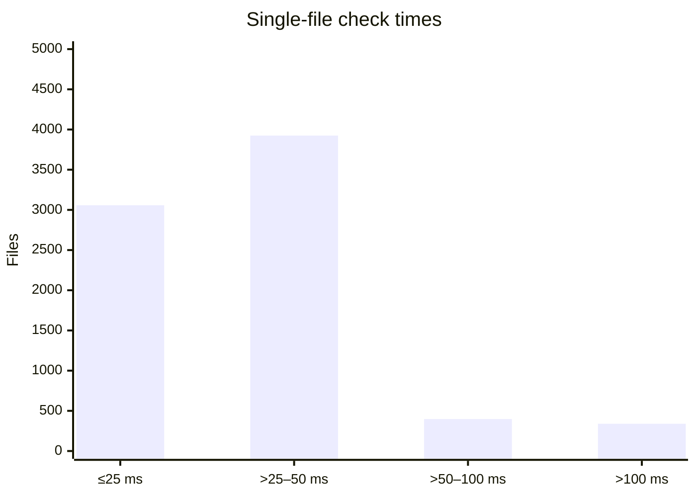

#  tift — A fast LaTeX and BibTeX formatter

[](https://www.rust-lang.org/)
[](LICENSE)

tift keeps the source of a shared paper easy to review. Equations and table columns line up, nested lists show their structure, and bibliography entries follow the same layout. Coauthors can share one `tift.toml` and use it in their editors and in CI.

**[Try the Playground](https://primex-06.github.io/tift/#playground)** — Paste your own LaTeX or BibTeX snippet and see the formatted source as you type.

[Install](#install) · [Quick start](#quick-start) · [Editor](#editor) · [User guide](https://github.com/PrimeX-06/tift/wiki)


## Install

Download the archive for Windows, Linux, or macOS, extract the executable, and add its directory to `PATH`. [Download tift 0.2.1](https://github.com/PrimeX-06/tift/releases/tag/v0.2.1)

With Rust 1.99.1 or later, you can also install tift using Cargo.

```sh
cargo install tift --locked --registry crates-io
tift --version
```

See the [installation guide](https://github.com/PrimeX-06/tift/wiki/Getting-Started) for platform setup, updates, and troubleshooting.

## Quick start

Preview the diff for one file. When you're happy with it, apply the changes.

```sh
tift --diff main.tex
tift main.tex
```

Working on an existing paper? Run `tift --diff --changed-since HEAD` to preview formatting on just the lines you edited. To format the whole project, run `tift .` from its root. Use `tift --check .` in CI.

You can also pass a bibliography (`references.bib`) or a BibTeX style file (`journal.bst`) in place of `main.tex`. [Command-line guide](https://github.com/PrimeX-06/tift/wiki/CLI)

## Performance

tift 0.2.1 took **26.6 ms** to check a TeX file on Windows 11 (median, including CLI startup). Across all 7,720 files, **90.5%** finished within 50 ms.



<details>
<summary>Benchmark setup and reproduction</summary>

The benchmark covers the TeX sources of 721 papers. It excludes nine files from a paper missing `astra-plain.bst`. [Benchmark corpus](https://github.com/openai/math/tree/adc7f1241b42e322a6451854ab7e4b4c146bf78a)

Each file’s time is the median of three separate CLI runs with one worker, default settings, and the tift cache disabled on Windows 11 (Core i9-14900HX). All 7,720 files completed without formatter errors.

```sh
python performance/openai_math.py --tift path/to/tift --all-files --runs 3
```

</details>

## Configuration

tift preserves prose line breaks by default. To wrap at 88 columns and indent by four spaces, save this as `tift.toml` beside your project's `main.tex`. Wrapping also supports Chinese, Japanese, and Korean text.

```toml
[indent]
width = 4

[wrap]
mode = "wrap"
columns = 88
```

tift loads the file automatically when you format the project. [Annotated configuration for 0.2.1](https://github.com/PrimeX-06/tift/blob/v0.2.1/examples/tift.toml)

## Editor

To use tift as the LaTeX formatter in VS Code, install [LaTeX Workshop](https://marketplace.visualstudio.com/items?itemName=James-Yu.latex-workshop) and make sure `tift` is on your `PATH`. Add these settings to `.vscode/settings.json` so the extension runs tift through its `latexindent` backend.

```json
{
    "latex-workshop.formatting.latex": "latexindent",
    "latex-workshop.formatting.latexindent.path": "tift",
    "latex-workshop.formatting.latexindent.args": ["--print", "%TMPFILE%"],
    "[latex]": {
        "editor.defaultFormatter": "James-Yu.latex-workshop"
    }
}
```

Open a `.tex` file and run **Format Document** from the Command Palette. To also format on save, add `"editor.formatOnSave": true` inside the `[latex]` block. [Editor guide](https://github.com/PrimeX-06/tift/wiki/VS-Code)

## Documentation

| Guide | Contents |
|---|---|
| [Formatting examples](https://github.com/PrimeX-06/tift/wiki/Formatting-Examples) | See how documents, tables, equations, and bibliographies are formatted |
| [Math](https://github.com/PrimeX-06/tift/wiki/Math-Formatting), [tables](https://github.com/PrimeX-06/tift/wiki/Table-Alignment), [bibliographies](https://github.com/PrimeX-06/tift/wiki/BibTeX), and [code](https://github.com/PrimeX-06/tift/wiki/Code-Formatting) | Feature behavior and settings |
| [Configuration](https://github.com/PrimeX-06/tift/wiki/Configuration) | Customize formatting rules |
| [Editor integration](https://github.com/PrimeX-06/tift/wiki/Editor-Integration) | VS Code, Neovim, pre-commit, and CI |
| [Supported syntax](https://github.com/PrimeX-06/tift/wiki/Supported-Syntax) | File types, packages, and formatting controls |

[Ask a question](https://github.com/PrimeX-06/tift/discussions) · [Report an issue](https://github.com/PrimeX-06/tift/issues)

## License

[MIT](LICENSE).
